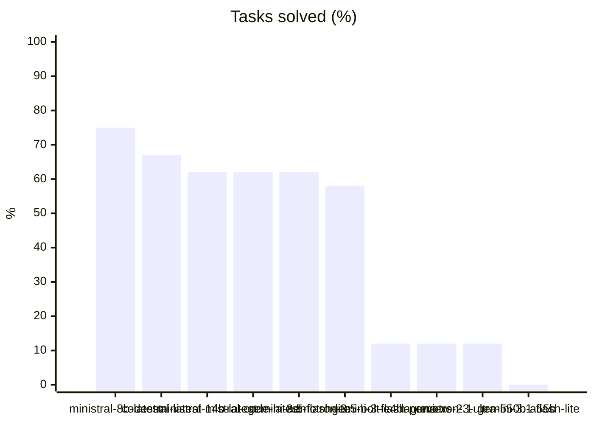
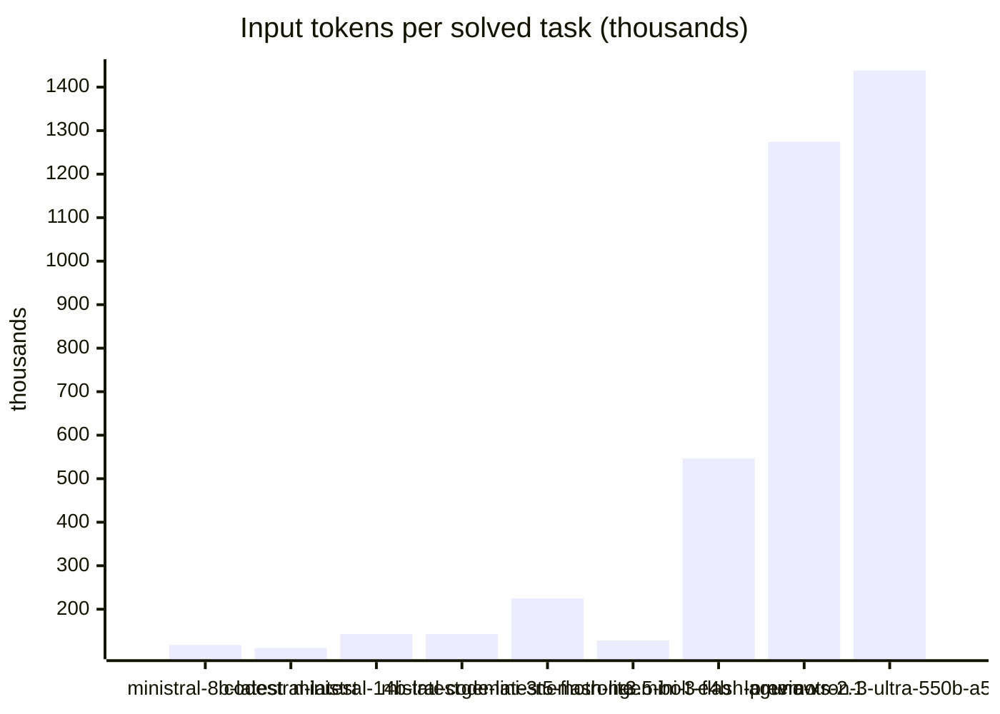

# Model Benchmark Report

Final run on 2026-11-19, agent at commit `56b4018`: 128 SWE-bench runs, ten
models on eight tasks, then two more passes of the three best models. An
earlier run on 2026-11-17 adds two providers on three tasks (section 1).

## 1. Setup

### Agent

One agent for every run: the same prompt, tools and limits (30 iterations,
300,000 input tokens, 10,000 output tokens, 900 s per task). Only
`--model-name` and `--provider-url` change between runs. Each run goes
through the subject's commands: `dump`, then `run-agent` (which kills the
agent at 900 s), then `validate`. A task counts as solved when `validate`
says `PASSED`. The task container has no network (`--network none`).

### Tasks

Eight SWE-bench Verified tasks from five repositories:

| Task | Repository | Why this task | Failing tests before any change |
|---|---|---|---|
| `sympy__sympy-14711` | sympy | suggested by the subject for first tests | 1 |
| `sympy__sympy-13480` | sympy | suggested by the subject for first tests | 1 |
| `pydata__xarray-4629` | xarray | suggested by the subject for first tests | 1 |
| `django__django-11066` | django | used during development, solved by the reference model | 1 |
| `scikit-learn__scikit-learn-13439` | scikit-learn | used during development, solved by the reference model | 1 |
| `sympy__sympy-18189` | sympy | used during development, solved by the reference model | 1 |
| `pytest-dev__pytest-7432` | pytest | added for this run: a new repository, difficulty "<15 min fix", tests that run in 5 s without network | 1 |
| `pytest-dev__pytest-5262` | pytest | same reasons | 1 |

The last column comes from each task's evaluation script, run once on the
unmodified repository without network: every task
starts with exactly one failing test, the one the fix must repair. It is the
baseline of the "partial progress" metric (section 4).

`pylint-dev__pylint-7277` was tried and dropped: its test file takes about
50 s per run, so the reference model reached the 900 s limit, and two of its
tests fail whatever the patch, because of the environment.

### Models and providers

Ten models, all on free tiers, with two keys per provider and key rotation:

| Provider | Models | Runs per task |
|---|---|---|
| Mistral | `codestral-latest`, `ministral-8b-latest`, `ministral-14b-latest`, `mistral-code-latest` | 3 for the first two, 1 for the others |
| Gemini | `gemini-3.5-flash-lite`, `gemini-3.1-flash-lite`, `gemini-3-flash-preview` | 1 |
| Nvidia | `nemotron-3.5-bolt-e4b`, `laguna-xs-2.1`, `nemotron-3-ultra-550b-a55b` | 3 for bolt, 1 for the others |

After one pass of all models, the three with the best pass rate
(`ministral-8b`, `codestral`, `nemotron-3.5-bolt`) ran twice more on the eight
tasks, to measure their variance: 24 runs each, 8 for the others.

**Earlier run with five providers (2026-11-17).** Cloudflare
(`nemotron-3-120b-a12b` 0/3, `mistral-small-3.1-24b` 1/3) and OpenRouter
(`nemotron-3-ultra-550b-a55b:free` 0/3) ran on three of the tasks
(django, scikit-learn, xarray). Their free quotas, 10,000 neurons per day for
Cloudflare and 100 requests per day for our two OpenRouter keys, cannot hold
eight tasks in a day, so they are not in the final run. Their runs are in
`benchmark/<model>/<task>/solution.json` and discussed in sections 3 and 7. In that earlier
run the container still had network access.

Models tried and not kept, with the reason (measured):

| Model | Provider | Reason |
|---|---|---|
| `gpt-oss-20b` | Groq | 0 code blocks in 40 calls (native tool call refused, or reasoning with no text) |
| any model | Groq | 8,000 tokens per minute per key: too low for SWE-bench |
| `qwen2.5-coder-32b`, `llama-3.3-70b` | Cloudflare | context window of 32k and 24k tokens |
| `qwen3.8-27b`, `gemma-4-26b` | Cloudflare | long outputs (922 and 637 tokens for one step) and 15 to 26 s per call |
| `gpt-oss-120b` | Cloudflare | several code blocks per answer and an invented observation, so the stop sequence never fires |
| `kimi-k2.6`, `glm-5.2`, `deepseek-v4-flash` | Cloudflare | HTTP 403, not available on the free plan |
| `mistral-large-4`, `mistral-medium`, `magistral` | Mistral | HTTP 403 (`tier_not_allowed`) or HTTP 429 on every call |
| `gemini-3.5-flash`, `3.7-flash`, `3.8-flash` | Gemini | timeouts at 60 s, then HTTP 503 "high demand" at 120 s |
| `nemotron-3.5-lightning-30b-a3b`, `nemotron-3.5-super-vl-120b-a12b` | Nvidia | reasoning models: their hidden reasoning quotes `<end_code>`, so the stop sequence ends the answer before any text (empty answer at every step) |
| `diffusiongemma-26b-a4b-it` | Nvidia | HTTP 410, the model was removed |
| `llama-4-scout-17b-16e-instruct`, `glm-4.7-flash` | Cloudflare | HTTP 429 on every call: daily quota used up by the other Cloudflare models |

### Reproducibility

Each run is the sequence of the subject (V.4), with the evaluation tool given
with the subject:

```sh
# once per task: the task file
uv run moulinette_eval dump swebench --task-id <task> --output task.json
# once per model and task: the agent under the 900 s limit, then the check
uv run moulinette_eval run-agent 900 "uv run python -m agent_swebench \
    --task-file task.json --output solution.json \
    --model-name <model> --provider-url <url>"
uv run moulinette_eval validate swebench task.json solution.json
```

The baseline of a task is its evaluation script (`eval_script` in
`task.json`) run once in a container of the task image started with
`--network none`, before any change. The metrics of sections 2 to 4 and 6
are computed from the steps of each `solution.json`, as defined in section 4.

Environment: a Linux machine with 7.7 GB of RAM and Docker, Python 3.10 with
uv, temperature 0. Two chains ran in parallel (Mistral, then Gemini and
Nvidia), and the models of one provider one after the other, so that two
models never share a provider's rate limit. A run waits until 700 MB of
memory are free. The final run took from 08:17 to 13:45.

## 2. Results

| Model | Provider | Solved | Rate (95 % CI) |
|---|---|---|---|
| `ministral-8b-latest` | mistral | 18/24 | 75% (55% to 88%) |
| `codestral-latest` | mistral | 16/24 | 67% (47% to 82%) |
| `ministral-14b-latest` | mistral | 5/8 | 62% (31% to 86%) |
| `mistral-code-latest` | mistral | 5/8 | 62% (31% to 86%) |
| `gemini-3.5-flash-lite` | gemini | 5/8 | 62% (31% to 86%) |
| `nvidia/nemotron-3.5-bolt-e4b` | nvidia | 14/24 | 58% (39% to 76%) |
| `gemini-3-flash-preview` | gemini | 1/8 | 12% (2% to 47%) |
| `poolside/laguna-xs-2.1` | nvidia | 1/8 | 12% (2% to 47%) |
| `nvidia/nemotron-3-ultra-550b-a55b` | nvidia | 1/8 | 12% (2% to 47%) |
| `gemini-3.1-flash-lite` | gemini | 0/8 | 0% (0% to 32%) |

The interval is the Wilson score interval at 95 %.



Each mark is one run, in order (✓ solved, ✗ failed):

| Model | django-11066 | scikit-learn-13439 | xarray-4629 | sympy-13480 | sympy-18189 | sympy-14711 | pytest-7432 | pytest-5262 |
|---|---|---|---|---|---|---|---|---|
| `ministral-8b-latest` | ✓ ✓ ✓ | ✓ ✓ ✓ | ✓ ✓ ✓ | ✓ ✓ ✓ | ✓ ✓ ✓ | ✗ ✗ ✗ | ✗ ✗ ✗ | ✓ ✓ ✓ |
| `codestral-latest` | ✓ ✓ ✓ | ✓ ✗ ✗ | ✓ ✓ ✓ | ✓ ✓ ✓ | ✓ ✓ ✓ | ✗ ✗ ✓ | ✓ ✗ ✗ | ✓ ✗ ✗ |
| `ministral-14b-latest` | ✓ | ✓ | ✓ | ✓ | ✓ | ✗ | ✗ | ✗ |
| `mistral-code-latest` | ✓ | ✓ | ✓ | ✓ | ✗ | ✗ | ✓ | ✗ |
| `gemini-3.5-flash-lite` | ✓ | ✗ | ✓ | ✓ | ✓ | ✗ | ✗ | ✓ |
| `nvidia/nemotron-3.5-bolt-e4b` | ✓ ✓ ✓ | ✓ ✗ ✓ | ✓ ✓ ✓ | ✓ ✓ ✓ | ✓ ✓ ✓ | ✗ ✗ ✗ | ✗ ✗ ✗ | ✗ ✗ ✗ |
| `gemini-3-flash-preview` | ✗ | ✗ | ✓ | ✗ | ✗ | ✗ | ✗ | ✗ |
| `poolside/laguna-xs-2.1` | ✗ | ✗ | ✗ | ✓ | ✗ | ✗ | ✗ | ✗ |
| `nvidia/nemotron-3-ultra-550b-a55b` | ✗ | ✗ | ✗ | ✓ | ✗ | ✗ | ✗ | ✗ |
| `gemini-3.1-flash-lite` | ✗ | ✗ | ✗ | ✗ | ✗ | ✗ | ✗ | ✗ |
| **all runs** | 12/16 | 8/16 | 13/16 | 14/16 | 11/16 | 1/16 | 2/16 | 5/16 |

The five measures of the subject (result, iterations, input tokens, output
tokens, wall-clock time) for each of the 128 runs are in Appendix A.

What the numbers show:

- **The three best models cannot be ranked against each other.**
  `ministral-8b` solves 18 of 24 runs, `codestral` 16 and `nemotron-3.5-bolt`
  14, and their 95 % intervals overlap widely. With 24 runs each, a gap of
  two or four tasks is within noise.
- **Repeating a run changes the result.** `codestral` solves
  `scikit-learn-13439`, `sympy-14711`, `pytest-7432` and `pytest-5262` once in
  three runs. `ministral-8b` is steadier: 3 out of 3 on six tasks and 0 out
  of 3 on the two others.
- **Two tasks separate the models.** `sympy-14711` is solved once in 16 runs
  and `pytest-7432` twice. `sympy-13480` (14 of 16) and `xarray-4629` (13 of
  16) are solved by almost every model that works at all.
- **Most failures are loops.** 62 of the 128 runs fail, and 42 runs end at
  the 30-iteration limit. On `pytest-7432`, one `codestral` run sends the
  same `edit_file` call to `skipping.py` 13 times.
- **Without network, two models collapse.** `laguna-xs-2.1` solved two of
  three tasks on 2026-11-17, when the container had network access, and
  `nemotron-3-ultra` one of three once the network was blocked. Here each
  solves one task of eight: they try `pip install` (15 and 35 times over their
  runs), it fails, and they loop to the limit. The images already contain
  every dependency of the tests.

## 3. Provider reliability

| Model | Provider | Steps | Average s per request | Retries | Availability |
|---|---|---|---|---|---|
| `ministral-8b-latest` | mistral | 379 | 12.6 | 165 | 24/24 |
| `codestral-latest` | mistral | 317 | 11.9 | 137 | 24/24 |
| `ministral-14b-latest` | mistral | 144 | 13.7 | 64 | 8/8 |
| `mistral-code-latest` | mistral | 119 | 11.6 | 54 | 8/8 |
| `gemini-3.5-flash-lite` | gemini | 172 | 2.5 | 3 | 8/8 |
| `nvidia/nemotron-3.5-bolt-e4b` | nvidia | 314 | 1.8 | 0 | 24/24 |
| `gemini-3-flash-preview` | gemini | 85 | 16.9 | 42 | 3/8 |
| `poolside/laguna-xs-2.1` | nvidia | 222 | 0.9 | 3 | 8/8 |
| `nvidia/nemotron-3-ultra-550b-a55b` | nvidia | 240 | 2.4 | 1 | 8/8 |
| `gemini-3.1-flash-lite` | gemini | 77 | 6.1 | 16 | 5/8 |

"Steps" counts the LLM requests that got an answer. "Availability" counts the
runs in which every request got an answer.

- **Nvidia** is the most reliable: 4 retries over 776 requests, 0.9 to
  2.4 s per request.
- **Mistral** answers every run (24/24, 8/8), but with 54 to 165 retries per
  model: rate limits, absorbed by the key rotation. It is also the slowest,
  about 12 s per request.
- **Mistral with five keys, after this run:** we added three Mistral keys
  and ran `codestral-latest` again on `pytest-dev__pytest-7432` and
  `sympy__sympy-14711`. Both runs reached 30 steps and spent 128 s and 182 s
  in LLM calls (4 to 6 s per request), against 329 to 439 s for the
  30-step runs of the same tasks with two keys. Both stopped at the
  iteration limit and failed, as before: the extra keys only cut the waiting
  time. The tables keep the two-key figures they were measured with.
- **Gemini** depends on the model. `gemini-3.5-flash-lite` is reliable (3
  retries). `gemini-3-flash-preview` stopped on HTTP 429 in five of its eight
  runs: the daily quota of a preview model is small. `gemini-3.1-flash-lite`
  lost three runs to native tool calls that the API rejects
  (`MALFORMED_FUNCTION_CALL`), although the prompt asks for Python blocks.
- **Earlier run:** the Cloudflare daily quota (10,000 neurons) held two
  models on three tasks, and the third model got HTTP 429 on every call.
  OpenRouter answered every request of its three runs.

## 4. Intermediary metrics

The three metrics of the subject, read from the steps of each `solution.json`:

- **Exploration efficiency:** the step that first names, in the code sent to
  the sandbox, a file that appears in the final patch.
- **Partial progress:** the first step where `run_tests` reports fewer
  failing tests than the baseline of the task (section 1).
- **Submission discipline:** the number of steps between the first `run_tests`
  whose tests pass and `final_answer` (0 is ideal). The tests count as passing
  when the failures reach the fewest seen in a validated run of the same task.

| Model | First touch of a patched file (median step) | Tests below baseline (median step) | Submitted at once after the tests passed |
|---|---|---|---|
| `ministral-8b-latest` | 2 | 5 (18 runs) | 14/18 |
| `codestral-latest` | 2 | 3.5 (16 runs) | 15/16 |
| `ministral-14b-latest` | 2 | 5 (5 runs) | 5/5 |
| `mistral-code-latest` | 2 | 4 (7 runs) | 4/5 |
| `gemini-3.5-flash-lite` | 1 | 4 (1 runs) | 0/5 |
| `nvidia/nemotron-3.5-bolt-e4b` | 2 | 3.5 (14 runs) | 13/14 |
| `gemini-3-flash-preview` | 1 | 15 (1 runs) | 1/1 |
| `poolside/laguna-xs-2.1` | 1 | - (0 runs) | 0/1 |
| `nvidia/nemotron-3-ultra-550b-a55b` | 1 | 5 (1 runs) | 0/1 |
| `gemini-3.1-flash-lite` | - | - (0 runs) | 0/0 |

Medians over the runs that reach the step. The last column counts, among the
solved runs, those that submitted right after the tests passed.

- **Finding the right file is not the problem.** Every model that edits at
  all names the file of its final patch at step 1 or 2.
- **Partial progress comes early.** For the models that solve tasks, the
  failing tests drop below the baseline around step 3.5 to 5.
- **Submission discipline separates the best models.** `codestral` submits
  at once in 15 of its 16 solved runs and `nemotron-3.5-bolt` in 13 of 14.
  `ministral-8b` does it in 14 of 18, and in the four others keeps going for
  4, 10, 12 and 22 steps after the tests passed.
- **Some passes are not verified by the agent.** Three solved runs never
  called `run_tests`, two of them by `gemini-3.5-flash-lite`.

## 5. Ablation study

Model: `codestral-latest`. Tasks: six SWE-bench Verified tasks (the three
of section 1, plus `sympy__sympy-13480`, `sympy__sympy-18189` and
`sympy__sympy-14711`), with `sympy__sympy-14711` run three times because it is unstable (8 runs per
condition). Only one thing changes per condition.

Each condition was measured twice. The first measurement is from 2026-11-12.
After it, two things changed in the agent: the prompt line that reads the
output of `run_tests`, and the tools, which now return a string instead of a
dictionary. All four conditions were then measured again on 2026-11-18 with
the final agent. The table reports the second measurement. The first one is
in the last column.

| Condition | Change | Pass (of 8) | `sympy-14711` (of 3) | Stable tasks (of 5) | Input tokens, 4 clean tasks | First measurement (pass of 8) |
|---|---|---|---|---|---|---|
| R | reference | 6 | 1 | 5 | 21,964 | 6 |
| A1 | remove `find_references` and `list_files` | 5 | 0 | 5 | 19,079 | 5 |
| A2 | `max_observation_chars` 6,000 to 12,000 | 5 | 1 | 4 | 22,113 | 5 |
| A3 | repeat detector off | 6 | 1 | 5 | 29,300 | 7 |

The four clean tasks are the ones that pass in every condition:
`sympy-13480`, `sympy-18189`, `scikit-learn-13439` and `xarray-4629`. The
input tokens are their mean per run.

How to read it:

- Each condition has eight runs, and each task ran once, so a gap of one
  pass is not evidence. The two measurements of the same condition give the
  same number of passes for R, A1 and A2, and differ by one for A3 (7, then
  6). That gap is the noise of this setup.
- The input tokens move in both directions between the two measurements.
  Against R, A3 used 11% fewer tokens the first time (19,321 against 21,641)
  and 33% more the second time (29,300 against 21,964). A2 went from 17%
  fewer to 1% more. A change that flips sign from one measurement to the
  next is noise.
- A2 loses one stable task each time, and it is a different one: the first
  time `scikit-learn-13439`, because the model wrote 10,000 output tokens in
  one answer, the second time `django-11066`, because the model sent the same
  `search_code` call 27 times with a malformed code fence. Neither failure
  comes from the observation limit.
- The repeat detector stays silent on the stable tasks that pass. It fires
  27 times in the one stable run that loops (`django-11066` in A2). On
  `sympy-14711` it fires 1 to 27 times per run, and the four runs where it
  fires 19 times or more all end at 30 iterations: the model ignores the
  warning. With the detector off (A3), `sympy-14711` passes once in three,
  like R.

The data shows three things: removing two tools costs nothing measurable,
raising the observation limit gains nothing, and the repeat detector warns
but does not stop a loop. It does not show that any of the three changes
improves the pass rate.

## 6. Cost analysis

All providers are free tiers, so the cost is in tokens, requests and time,
which the subject limits per task. The table divides the totals of all runs,
failed ones included, by the number of tasks solved.

| Model | Solved | Input tokens per solve | Output tokens per solve | Requests per solve | Seconds per solve |
|---|---|---|---|---|---|
| `ministral-8b-latest` | 18 | 117,627 | 3,099 | 30 | 330 |
| `codestral-latest` | 16 | 111,007 | 1,899 | 28 | 294 |
| `ministral-14b-latest` | 5 | 142,747 | 2,782 | 42 | 447 |
| `mistral-code-latest` | 5 | 143,468 | 2,224 | 35 | 467 |
| `gemini-3.5-flash-lite` | 5 | 224,977 | 4,240 | 35 | 167 |
| `nvidia/nemotron-3.5-bolt-e4b` | 14 | 127,827 | 3,132 | 22 | 119 |
| `gemini-3-flash-preview` | 1 | 546,648 | 40,800 | 127 | 1567 |
| `poolside/laguna-xs-2.1` | 1 | 1,273,967 | 20,021 | 225 | 489 |
| `nvidia/nemotron-3-ultra-550b-a55b` | 1 | 1,437,958 | 21,552 | 241 | 1336 |
| `gemini-3.1-flash-lite` | 0 | - | - | - | - |



- `codestral` and `ministral-8b` cost the same per solved task (111,000 and
  118,000 input tokens), but not per success: when it solves a task,
  `codestral` needs 4.8 iterations and 19,692 input tokens on average, against
  11.1 and 61,720 for `ministral-8b`.
- `nemotron-3.5-bolt` is the fastest: 119 s per solved task, against 294 to
  467 s for the Mistral models, whose rate limits add waiting time.
- A model that solves one task in eight costs ten times more per solve
  (546,000 to 1.4 million input tokens), because its failures run to the
  iteration limit.

## 7. Conclusions

### Selected models

Each agent has its own default model, in `configs/agent_*.json`.

- **SWE-bench: `codestral-latest`.** Its pass rate (67 %) is not
  significantly different from `ministral-8b` (75 %), and it is the most
  efficient when it succeeds: 4.8 iterations and 19,692 input tokens per
  solved run, the best submission discipline (15 of 16), and the ablations
  were run on it. `ministral-8b-latest` is the steadier alternative.
- **MBPP: `nemotron-3.5-bolt-e4b` (Nvidia).** Chosen from 15 rounds of five
  random MBPP tasks per candidate, the format of subject VI:

  | Model | Rounds with 4 or more of 5 | Tasks | Retries | Slowest task |
  |---|---|---|---|---|
  | `ministral-8b-latest` | 14/15 | 65/74 | 71 | 78 s |
  | `nemotron-3.5-bolt-e4b` | 13/15 | 64/74 | 0 | 25 s |
  | `codestral-latest` | 12/15 | 62/73 | 75 | 70 s |

  The pass rates are within noise. Bolt never needed a retry and never took
  more than 25 s, where the Mistral models had retries on two tasks out of
  three and one call that failed on HTTP 429. MBPP allows 120 s per task, and
  a failed task is not run again. MBPP and SWE-bench also use different
  providers, so they do not share rate limits when they run at the same time.

### Models to disregard

- `gemini-3.1-flash-lite`: 0/8. It makes native tool calls that the API
  rejects, despite the prompt.
- `gemini-3-flash-preview`: 1/8. Five runs stopped on the provider's daily
  quota: not usable on a free tier.
- `laguna-xs-2.1` and `nemotron-3-ultra-550b-a55b`: 1/8 each, almost every
  run at the iteration limit, trying to install packages without network.
- From the earlier run: `nemotron-3-120b-a12b` (Cloudflare, 0/3, every run at
  the limit) and the OpenRouter version of `nemotron-3-ultra` (0/3).
- Reasoning models with our stop sequence (`nemotron-3.5-lightning`,
  `nemotron-3.5-super-vl`, `gpt-oss`): empty answers.

### Findings

1. **The network was a hidden dependency.** Two models that looked usable
   with network access solve one task in eight without it. A benchmark run
   with network would have ranked them well above their real level.
2. **A stop sequence can silence a reasoning model.** The model quotes
   `<end_code>` while it reasons, the provider stops there, and the answer is
   empty. The same model answers correctly without the stop sequence.
3. **The same model behaves differently across providers.** In the earlier
   run, `nemotron-3-ultra` solved 1/3 on Nvidia and 0/3 on OpenRouter, where
   it called its tools without `print` and read "printed nothing" until the
   limit. One task is within noise, but the behaviour differs.
4. **Pass rate and efficiency rank models differently.** `ministral-8b`
   solves the most, `codestral` solves with the fewest iterations and tokens.
   The choice depends on what the limits make expensive.
5. **Agents fail by looping, not by getting lost.** They find the right file
   by step 2, then most failures repeat a call until the limit, even when the
   repeat detector warns them (section 5).

### Limits of this benchmark

- Eight tasks, and one run per task for seven of the ten models: one task
  more or less moves those models by 12.5 points.
- Three of the five repositories have one task each (django, scikit-learn,
  xarray), and three tasks come from sympy.
- Free-tier quotas shape the results: a preview model or a small daily quota
  removes runs that say nothing about the model.

## 8. Raw data

```
benchmark/runs/<model>/<task>/run<N>/solution.json      final run: the 128 runs of sections 2 to 4 and 6
benchmark/ablations/<condition>/<date>/<task>/solution.json  the ablation runs (section 5)
benchmark/<model>/<task>/solution.json                  earlier run, 2026-11-17 (11 models, 3 tasks)
```

## Appendix A. Every run

| Model | Task | Result | Iterations | Input tokens | Output tokens | Time (s) |
|---|---|---|---|---|---|---|
| `ministral-8b-latest` | django__django-11066 | PASS | 8 | 35,210 | 742 | 92 |
| `ministral-8b-latest` | django__django-11066 | PASS | 13 | 56,072 | 1,103 | 153 |
| `ministral-8b-latest` | django__django-11066 | PASS | 9 | 41,101 | 980 | 95 |
| `ministral-8b-latest` | pydata__xarray-4629 | PASS | 5 | 20,691 | 426 | 72 |
| `ministral-8b-latest` | pydata__xarray-4629 | PASS | 5 | 20,595 | 381 | 71 |
| `ministral-8b-latest` | pydata__xarray-4629 | PASS | 5 | 20,600 | 386 | 86 |
| `ministral-8b-latest` | pytest-dev__pytest-5262 | PASS | 15 | 90,136 | 1,448 | 263 |
| `ministral-8b-latest` | pytest-dev__pytest-5262 | PASS | 18 | 118,862 | 2,080 | 326 |
| `ministral-8b-latest` | pytest-dev__pytest-5262 | PASS | 27 | 192,523 | 2,803 | 427 |
| `ministral-8b-latest` | pytest-dev__pytest-7432 | FAIL | 30 | 177,549 | 4,285 | 495 |
| `ministral-8b-latest` | pytest-dev__pytest-7432 | FAIL | 30 | 164,114 | 3,342 | 454 |
| `ministral-8b-latest` | pytest-dev__pytest-7432 | FAIL | 30 | 202,639 | 5,858 | 455 |
| `ministral-8b-latest` | scikit-learn__scikit-learn-13439 | PASS | 13 | 65,780 | 1,759 | 200 |
| `ministral-8b-latest` | scikit-learn__scikit-learn-13439 | PASS | 15 | 73,352 | 1,505 | 213 |
| `ministral-8b-latest` | scikit-learn__scikit-learn-13439 | PASS | 12 | 60,649 | 1,466 | 155 |
| `ministral-8b-latest` | sympy__sympy-13480 | PASS | 5 | 15,869 | 367 | 72 |
| `ministral-8b-latest` | sympy__sympy-13480 | PASS | 5 | 15,923 | 389 | 72 |
| `ministral-8b-latest` | sympy__sympy-13480 | PASS | 5 | 16,373 | 424 | 73 |
| `ministral-8b-latest` | sympy__sympy-14711 | FAIL | 29 | 186,963 | 10,000 | 429 |
| `ministral-8b-latest` | sympy__sympy-14711 | FAIL | 30 | 138,091 | 3,859 | 459 |
| `ministral-8b-latest` | sympy__sympy-14711 | FAIL | 30 | 136,972 | 3,450 | 455 |
| `ministral-8b-latest` | sympy__sympy-18189 | PASS | 5 | 20,568 | 459 | 93 |
| `ministral-8b-latest` | sympy__sympy-18189 | PASS | 29 | 220,186 | 7,671 | 584 |
| `ministral-8b-latest` | sympy__sympy-18189 | PASS | 6 | 26,468 | 600 | 150 |
| `codestral-latest` | django__django-11066 | PASS | 7 | 27,900 | 335 | 90 |
| `codestral-latest` | django__django-11066 | PASS | 6 | 23,462 | 277 | 90 |
| `codestral-latest` | django__django-11066 | PASS | 6 | 23,685 | 289 | 87 |
| `codestral-latest` | pydata__xarray-4629 | PASS | 5 | 21,714 | 270 | 39 |
| `codestral-latest` | pydata__xarray-4629 | PASS | 5 | 21,714 | 270 | 131 |
| `codestral-latest` | pydata__xarray-4629 | PASS | 4 | 16,094 | 193 | 87 |
| `codestral-latest` | pytest-dev__pytest-5262 | PASS | 4 | 19,877 | 202 | 46 |
| `codestral-latest` | pytest-dev__pytest-5262 | FAIL | 30 | 280,823 | 2,377 | 450 |
| `codestral-latest` | pytest-dev__pytest-5262 | FAIL | 30 | 218,239 | 4,420 | 456 |
| `codestral-latest` | pytest-dev__pytest-7432 | PASS | 6 | 22,377 | 381 | 132 |
| `codestral-latest` | pytest-dev__pytest-7432 | FAIL | 30 | 175,673 | 4,168 | 450 |
| `codestral-latest` | pytest-dev__pytest-7432 | FAIL | 30 | 176,517 | 4,202 | 475 |
| `codestral-latest` | scikit-learn__scikit-learn-13439 | PASS | 4 | 14,341 | 248 | 29 |
| `codestral-latest` | scikit-learn__scikit-learn-13439 | FAIL | 30 | 154,973 | 2,328 | 388 |
| `codestral-latest` | scikit-learn__scikit-learn-13439 | FAIL | 30 | 144,001 | 2,131 | 384 |
| `codestral-latest` | sympy__sympy-13480 | PASS | 4 | 13,582 | 196 | 41 |
| `codestral-latest` | sympy__sympy-13480 | PASS | 4 | 13,629 | 181 | 37 |
| `codestral-latest` | sympy__sympy-13480 | PASS | 4 | 13,593 | 207 | 37 |
| `codestral-latest` | sympy__sympy-14711 | FAIL | 30 | 151,442 | 2,546 | 388 |
| `codestral-latest` | sympy__sympy-14711 | FAIL | 30 | 159,386 | 3,720 | 461 |
| `codestral-latest` | sympy__sympy-14711 | PASS | 5 | 21,479 | 433 | 70 |
| `codestral-latest` | sympy__sympy-18189 | PASS | 3 | 11,849 | 221 | 91 |
| `codestral-latest` | sympy__sympy-18189 | PASS | 3 | 11,829 | 191 | 86 |
| `codestral-latest` | sympy__sympy-18189 | PASS | 7 | 37,939 | 597 | 151 |
| `ministral-14b-latest` | django__django-11066 | PASS | 10 | 42,977 | 809 | 152 |
| `ministral-14b-latest` | pydata__xarray-4629 | PASS | 6 | 28,081 | 508 | 93 |
| `ministral-14b-latest` | pytest-dev__pytest-5262 | FAIL | 30 | 171,888 | 2,357 | 456 |
| `ministral-14b-latest` | pytest-dev__pytest-7432 | FAIL | 28 | 151,498 | 3,359 | 486 |
| `ministral-14b-latest` | scikit-learn__scikit-learn-13439 | PASS | 29 | 147,028 | 3,113 | 417 |
| `ministral-14b-latest` | sympy__sympy-13480 | PASS | 5 | 16,137 | 342 | 71 |
| `ministral-14b-latest` | sympy__sympy-14711 | FAIL | 30 | 129,535 | 2,866 | 401 |
| `ministral-14b-latest` | sympy__sympy-18189 | PASS | 6 | 26,590 | 556 | 158 |
| `mistral-code-latest` | django__django-11066 | PASS | 6 | 23,703 | 295 | 207 |
| `mistral-code-latest` | pydata__xarray-4629 | PASS | 5 | 21,714 | 270 | 73 |
| `mistral-code-latest` | pytest-dev__pytest-5262 | FAIL | 30 | 218,937 | 4,626 | 456 |
| `mistral-code-latest` | pytest-dev__pytest-7432 | PASS | 5 | 17,928 | 314 | 71 |
| `mistral-code-latest` | scikit-learn__scikit-learn-13439 | PASS | 12 | 48,093 | 690 | 151 |
| `mistral-code-latest` | sympy__sympy-13480 | PASS | 4 | 13,567 | 181 | 37 |
| `mistral-code-latest` | sympy__sympy-14711 | FAIL | 30 | 147,697 | 2,228 | 450 |
| `mistral-code-latest` | sympy__sympy-18189 | FAIL | 27 | 225,699 | 2,516 | 888 |
| `gemini-3.5-flash-lite` | django__django-11066 | PASS | 16 | 92,545 | 1,813 | 64 |
| `gemini-3.5-flash-lite` | pydata__xarray-4629 | PASS | 30 | 182,526 | 1,746 | 129 |
| `gemini-3.5-flash-lite` | pytest-dev__pytest-5262 | PASS | 24 | 197,295 | 3,672 | 184 |
| `gemini-3.5-flash-lite` | pytest-dev__pytest-7432 | FAIL | 30 | 250,616 | 7,284 | 112 |
| `gemini-3.5-flash-lite` | scikit-learn__scikit-learn-13439 | FAIL | 15 | 75,676 | 1,916 | 43 |
| `gemini-3.5-flash-lite` | sympy__sympy-13480 | PASS | 8 | 31,419 | 453 | 58 |
| `gemini-3.5-flash-lite` | sympy__sympy-14711 | FAIL | 30 | 191,336 | 3,187 | 124 |
| `gemini-3.5-flash-lite` | sympy__sympy-18189 | PASS | 19 | 103,472 | 1,127 | 121 |
| `nvidia/nemotron-3.5-bolt-e4b` | django__django-11066 | PASS | 3 | 12,475 | 276 | 29 |
| `nvidia/nemotron-3.5-bolt-e4b` | django__django-11066 | PASS | 3 | 12,475 | 276 | 27 |
| `nvidia/nemotron-3.5-bolt-e4b` | django__django-11066 | PASS | 3 | 12,475 | 276 | 28 |
| `nvidia/nemotron-3.5-bolt-e4b` | pydata__xarray-4629 | PASS | 4 | 17,467 | 368 | 30 |
| `nvidia/nemotron-3.5-bolt-e4b` | pydata__xarray-4629 | PASS | 4 | 17,472 | 374 | 30 |
| `nvidia/nemotron-3.5-bolt-e4b` | pydata__xarray-4629 | PASS | 5 | 21,868 | 474 | 31 |
| `nvidia/nemotron-3.5-bolt-e4b` | pytest-dev__pytest-5262 | FAIL | 7 | 41,506 | 902 | 87 |
| `nvidia/nemotron-3.5-bolt-e4b` | pytest-dev__pytest-5262 | FAIL | 7 | 43,740 | 893 | 83 |
| `nvidia/nemotron-3.5-bolt-e4b` | pytest-dev__pytest-5262 | FAIL | 7 | 41,508 | 891 | 82 |
| `nvidia/nemotron-3.5-bolt-e4b` | pytest-dev__pytest-7432 | FAIL | 30 | 152,858 | 3,092 | 104 |
| `nvidia/nemotron-3.5-bolt-e4b` | pytest-dev__pytest-7432 | FAIL | 30 | 143,489 | 2,682 | 64 |
| `nvidia/nemotron-3.5-bolt-e4b` | pytest-dev__pytest-7432 | FAIL | 30 | 150,466 | 2,929 | 86 |
| `nvidia/nemotron-3.5-bolt-e4b` | scikit-learn__scikit-learn-13439 | PASS | 4 | 15,753 | 376 | 26 |
| `nvidia/nemotron-3.5-bolt-e4b` | scikit-learn__scikit-learn-13439 | FAIL | 28 | 178,597 | 4,865 | 92 |
| `nvidia/nemotron-3.5-bolt-e4b` | scikit-learn__scikit-learn-13439 | PASS | 4 | 15,753 | 376 | 25 |
| `nvidia/nemotron-3.5-bolt-e4b` | sympy__sympy-13480 | PASS | 11 | 40,674 | 1,032 | 49 |
| `nvidia/nemotron-3.5-bolt-e4b` | sympy__sympy-13480 | PASS | 11 | 40,660 | 1,023 | 51 |
| `nvidia/nemotron-3.5-bolt-e4b` | sympy__sympy-13480 | PASS | 10 | 36,535 | 957 | 50 |
| `nvidia/nemotron-3.5-bolt-e4b` | sympy__sympy-14711 | FAIL | 30 | 235,838 | 7,268 | 108 |
| `nvidia/nemotron-3.5-bolt-e4b` | sympy__sympy-14711 | FAIL | 30 | 233,209 | 6,674 | 126 |
| `nvidia/nemotron-3.5-bolt-e4b` | sympy__sympy-14711 | FAIL | 30 | 210,409 | 5,067 | 91 |
| `nvidia/nemotron-3.5-bolt-e4b` | sympy__sympy-18189 | PASS | 8 | 41,693 | 1,162 | 172 |
| `nvidia/nemotron-3.5-bolt-e4b` | sympy__sympy-18189 | PASS | 8 | 39,366 | 825 | 95 |
| `nvidia/nemotron-3.5-bolt-e4b` | sympy__sympy-18189 | PASS | 7 | 33,297 | 796 | 95 |
| `gemini-3-flash-preview` | django__django-11066 | FAIL | 13 | 94,111 | 10,000 | 95 |
| `gemini-3-flash-preview` | pydata__xarray-4629 | PASS | 16 | 125,548 | 4,415 | 186 |
| `gemini-3-flash-preview` | pytest-dev__pytest-5262 | FAIL | 1 | 0 | 0 | 130 |
| `gemini-3-flash-preview` | pytest-dev__pytest-7432 | FAIL | 1 | 0 | 0 | 129 |
| `gemini-3-flash-preview` | scikit-learn__scikit-learn-13439 | FAIL | 12 | 94,809 | 10,000 | 86 |
| `gemini-3-flash-preview` | sympy__sympy-13480 | FAIL | 19 | 101,353 | 9,996 | 281 |
| `gemini-3-flash-preview` | sympy__sympy-14711 | FAIL | 2 | 3,141 | 1,088 | 191 |
| `gemini-3-flash-preview` | sympy__sympy-18189 | FAIL | 21 | 127,686 | 5,301 | 469 |
| `poolside/laguna-xs-2.1` | django__django-11066 | FAIL | 30 | 146,705 | 1,748 | 37 |
| `poolside/laguna-xs-2.1` | pydata__xarray-4629 | FAIL | 30 | 180,266 | 3,634 | 48 |
| `poolside/laguna-xs-2.1` | pytest-dev__pytest-5262 | FAIL | 30 | 210,987 | 3,953 | 43 |
| `poolside/laguna-xs-2.1` | pytest-dev__pytest-7432 | FAIL | 30 | 119,426 | 762 | 18 |
| `poolside/laguna-xs-2.1` | scikit-learn__scikit-learn-13439 | FAIL | 30 | 173,535 | 2,240 | 59 |
| `poolside/laguna-xs-2.1` | sympy__sympy-13480 | PASS | 12 | 51,619 | 733 | 54 |
| `poolside/laguna-xs-2.1` | sympy__sympy-14711 | FAIL | 30 | 123,198 | 1,168 | 27 |
| `poolside/laguna-xs-2.1` | sympy__sympy-18189 | FAIL | 30 | 268,231 | 5,783 | 202 |
| `nvidia/nemotron-3-ultra-550b-a55b` | django__django-11066 | FAIL | 30 | 264,551 | 2,813 | 311 |
| `nvidia/nemotron-3-ultra-550b-a55b` | pydata__xarray-4629 | FAIL | 30 | 216,790 | 3,872 | 263 |
| `nvidia/nemotron-3-ultra-550b-a55b` | pytest-dev__pytest-5262 | FAIL | 30 | 203,994 | 2,892 | 182 |
| `nvidia/nemotron-3-ultra-550b-a55b` | pytest-dev__pytest-7432 | FAIL | 30 | 156,603 | 3,477 | 203 |
| `nvidia/nemotron-3-ultra-550b-a55b` | scikit-learn__scikit-learn-13439 | FAIL | 30 | 173,105 | 1,815 | 62 |
| `nvidia/nemotron-3-ultra-550b-a55b` | sympy__sympy-13480 | PASS | 30 | 140,486 | 2,514 | 150 |
| `nvidia/nemotron-3-ultra-550b-a55b` | sympy__sympy-14711 | FAIL | 30 | 107,772 | 1,190 | 81 |
| `nvidia/nemotron-3-ultra-550b-a55b` | sympy__sympy-18189 | FAIL | 30 | 174,657 | 2,979 | 83 |
| `gemini-3.1-flash-lite` | django__django-11066 | FAIL | 3 | 14,253 | 1,766 | 25 |
| `gemini-3.1-flash-lite` | pydata__xarray-4629 | FAIL | 4 | 19,380 | 1,593 | 38 |
| `gemini-3.1-flash-lite` | pytest-dev__pytest-5262 | FAIL | 4 | 62,392 | 2,280 | 39 |
| `gemini-3.1-flash-lite` | pytest-dev__pytest-7432 | FAIL | 8 | 113,806 | 6,655 | 66 |
| `gemini-3.1-flash-lite` | scikit-learn__scikit-learn-13439 | FAIL | 12 | 57,659 | 2,010 | 90 |
| `gemini-3.1-flash-lite` | sympy__sympy-13480 | FAIL | 6 | 77,789 | 5,545 | 50 |
| `gemini-3.1-flash-lite` | sympy__sympy-14711 | FAIL | 30 | 182,532 | 4,579 | 217 |
| `gemini-3.1-flash-lite` | sympy__sympy-18189 | FAIL | 10 | 46,200 | 1,280 | 37 |
