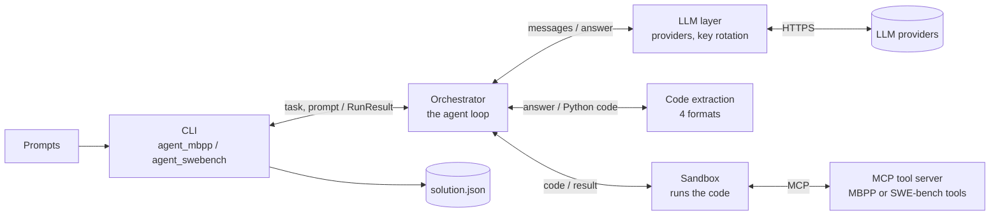
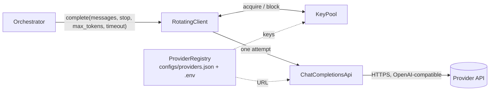
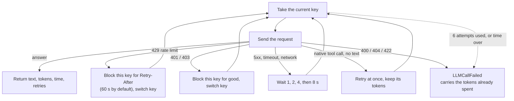
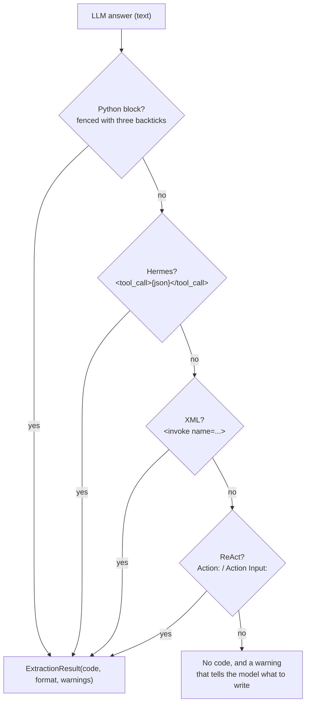
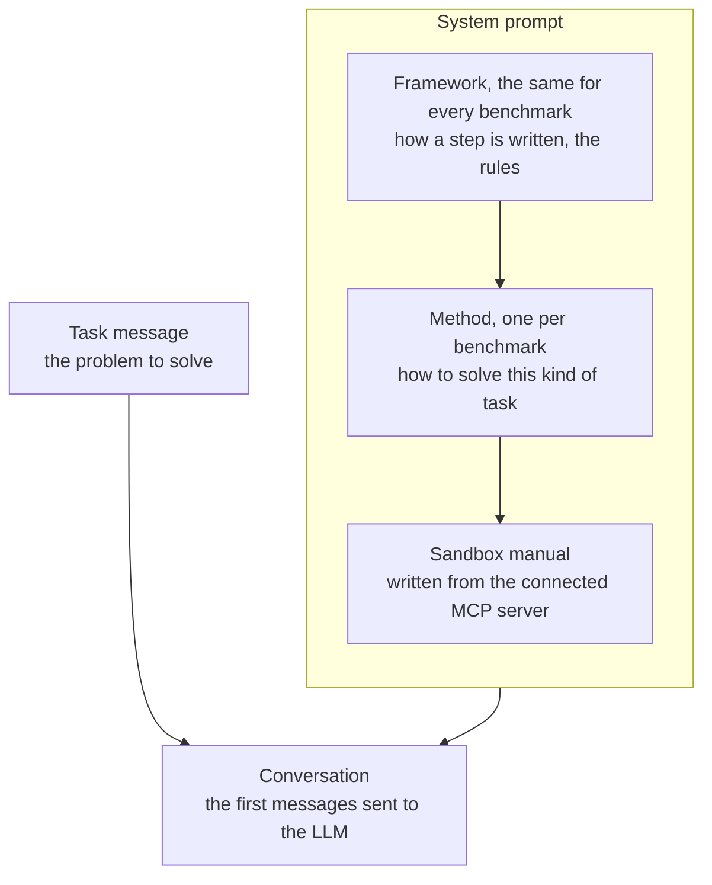
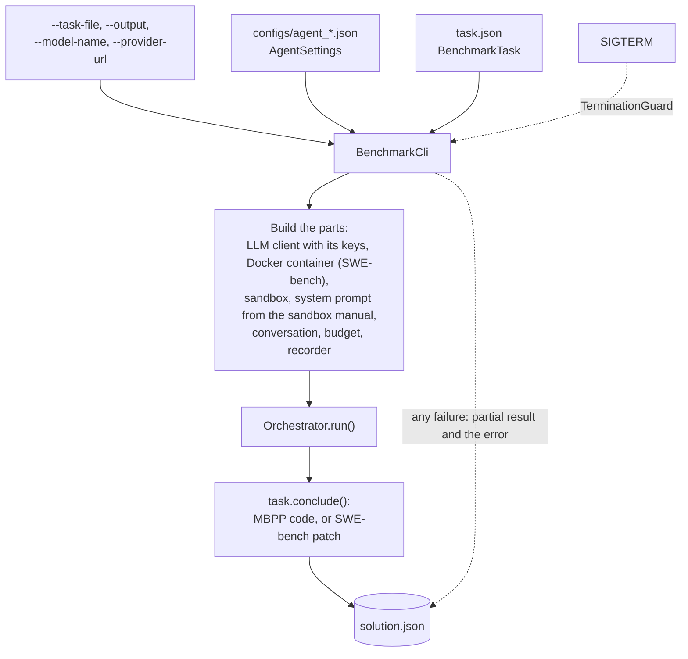
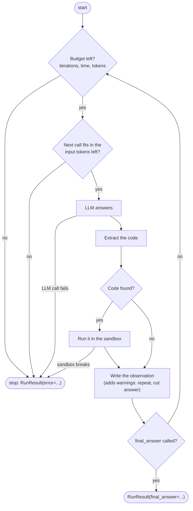
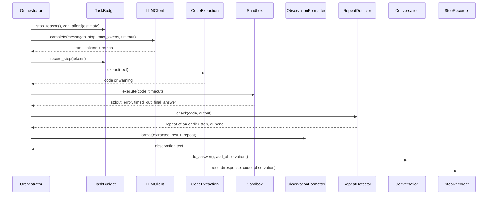
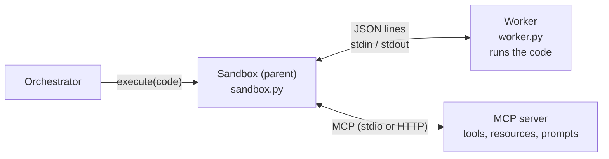

*This project has been created as part of the 42 curriculum by qdecross, bfitte.*

# Agent Smith

## Description

Agent Smith is a code agent built from scratch, without any agent
orchestration library. It solves a task by repeating a loop: the language
model writes a thought and a block of Python, the code runs in a sandbox,
and the result goes back to the model as an observation. The loop ends when
the model calls `final_answer`, or when a limit is reached.

The same agent runs two benchmarks:

- **MBPP**: write one Python function that passes a list of assertions.
- **SWE-bench**: fix an issue in a real repository, inside a Docker
  container, and return a patch.

The agent works with free LLM providers only (Mistral, Gemini, Cloudflare
Workers AI, Nvidia, OpenRouter). Each provider has several API keys, and the
agent rotates between them when one is rate limited.

## Instructions

### Installation

```bash
# Install dependencies
uv sync

#Copy the .env_example file to .env and add your API keys
cp .env.example .env
```

### Run the agent

```bash
# MBPP
uv run python -m agent_mbpp \
    --task-file task.json --output solution.json \
    --model-name codestral-latest \
    --provider-url https://api.mistral.ai/v1

# SWE-bench (the task image must be available in Docker)
uv run python -m agent_swebench \
    --task-file task.json --output solution.json \
    --model-name codestral-latest \
    --provider-url https://api.mistral.ai/v1
```

`--provider-url` selects the provider; the matching keys are found in `.env`.
The default settings are in `configs/agent_mbpp.json` and
`configs/agent_swebench.json` (model, iteration limit, how many observations
stay in full, and so on). The agent always writes `solution.json`, whatever
happens during the task.

### Makefile commands

  ``make install``     - Install dependencies

  ``make run``         - Run the sandbox CLI without MCP server

  ``make run-stdio-mbpp``   - Run the sandbox CLI with MBPP MCP server over stdio. make run-stdio-mbpp [CONFIG=...] [MCP_MBPP_CMD=...]

  ``make run-stdio-swebench``   - Run the sandbox CLI with SWE-Bench MCP server over stdio. make run-stdio-swebench [CONFIG=...] [MCP_SWE_CMD=...]

  ``make run-server``  - Run the sandbox CLI with MCP server over HTTP. If you keep the default value for MCP_URL, you must first run **make serve-http** to start an MCP server over HTTP. make run-server [CONFIG=...] [MCP_URL=...]

  ``make serve-http``       - Run the MBPP MCP server over HTTP on localhost:8000.

  ``make clean``       - Clean temporary files

  ``make clean-all``   - Clean virtual environment and temporary files

  ``make lint``        - Run linters and type checkers

  ``make lint-strict`` - Run linters and type checkers in strict mode

### Manual instructions

``uv sync`` - Installation (make install)

``uv run sandbox`` - Just sandbox, without MCP server (make run)

``uv run sandbox configs/sandbox_template.json``      - With personal configuration

``uv run sandbox --mcp-stdio "python3 mcp_tools_mbpp.py" <your config path>`` - Sandbox + MBPP MCP server over stdio (make run-stdio-mbpp)

``TESTBED_PATH=<repository path> uv run sandbox --mcp-stdio "python3 mcp_tools_swebench.py" <your config path>`` - Sandbox + SWE-Bench MCP server over stdio (make run-stdio-swebench)

**TESTBED_PATH** (required by the SWE-bench server): root of the repository the tools work on. Every path given to a tool must stay inside it, and commands are run from it.

``uv run fastmcp run mcp_tools_mbpp.py --transport http --port 8000`` - MBPP MCP server over HTTP in a terminal (make serve-http)

``uv run sandbox --mcp-server http://localhost:8000/mcp configs/sandbox_template.json`` - Sandbox connected to this server in another terminal (make run-server)


## System architecture



Each box is a package of `src/`. The orchestrator only sees interfaces: an
`LLMClient` for the model and a sandbox port for the code execution. Each
part is passed to its constructor, so it can be replaced by a fake object.

The CLI is the entry point of each agent: it reads the command-line options, builds every part of the agent, runs the loop and writes `solution.json`. Nothing is typed in the terminal while the agent runs.

| Package | Role |
|---|---|
| `src/cli` | Command lines, task loading, wiring of all parts, `solution.json` |
| `src/orchestrator` | The loop, the budget, the conversation, the feedback to the model |
| `src/llm` | One HTTP call, retries, key rotation, token counting |
| `src/extraction` | From the model's answer to Python code |
| `src/prompts` | The system prompt and the task message of each benchmark |
| `src/sandbox` | Code execution and MCP client (see "Sandbox design") |
| `mcp_tools_mbpp.py` | MCP tool servers, see Tool implementation details" |
| `mcp_tools_swebench.py` | MCP tool servers, see Tool implementation details" |

### LLM layer

`RotatingClient` sends the conversation to a provider and hides everything
that can go wrong: rate limits, dead keys, outages and timeouts. Every
provider speaks the OpenAI chat format, so switching provider means changing
`--provider-url`, not code.



How one call reacts to each failure:



A call ends after 6 attempts, or when its time is up. When every attempt
fails, `LLMCallFailed` carries the tokens already spent, so the trace stays
honest. Tokens of discarded native-tool-call attempts are added to the answer
that finally succeeds, because the provider counted them.

The clock and the sleep function are injected, so long waits can be
simulated instantly when checking the retry logic. To add a provider, add an entry in `configs/providers.json`
and its keys in `.env`: no code.

### Code extraction

Models do not always answer in the same format. `CodeExtraction` finds the
code in the answer and turns it into Python, so the sandbox only ever sees
Python.



The first extractor that recognises its format decides. The chain always
returns a result, so the orchestrator never handles `None`.

| Format | What the model writes | Python handed to the sandbox |
|---|---|---|
| Python block (primary) | a `python` fenced block, then `<end_code>` | the block, as is |
| Hermes | `<tool_call>{"name": "read_file", "arguments": {...}}</tool_call>` | `read_file(filepath=...)` |
| XML | `<invoke name="read_file"><parameter name="filepath">...` | `read_file(filepath=...)` |
| ReAct | `Action: read_file` and `Action Input: {...}` | `read_file(filepath=...)` |

When a block is malformed but can still be interpreted (for example a fence
that is not closed), the result says how it was repaired, and the model reads
that warning in the next observation. ReAct comes last on purpose: it is the
loosest format, so a stray `Action:` line is only considered when nothing
else matches.

### System prompt

One class per benchmark builds the two texts that start a task.



The tools are never described in the prompt files. The manual comes from the
sandbox, built from the tool schemas of the connected MCP server, so an
unknown server works the same way.

| | MBPP (`MbppPrompt`) | SWE-bench (`SweBenchPrompt`) |
|---|---|---|
| Goal | write one Python function | fix an issue in a real repository |
| Steps | write the function, check it with `run_tests(code, TESTS)` in the same block, fix, then `final_answer(code)` | find the code, read it, reproduce the bug, fix with `edit_file`, run the tests, then `final_answer(get_patch())` |
| Size | as short as possible: the system prompt is sent at every step and MBPP allows 6,000 input tokens for the whole task | longer, with a worked example of three steps |

Each line of the prompt costs tokens at every step, so a change is measured
before it is kept: a few lines can move the pass rate on MBPP. The SWE-bench
prompt also tells the agent to work only from the repository and the tools,
and never to look for the fix in a pull request, an issue or any outside
source.

### Command lines and containers

`BenchmarkCli` holds everything the two agents share. A subclass only says
which benchmark it runs, how to read its task and which limits apply.



What always happens:

- `solution.json` is written whatever the outcome of the task. The exit code
  is 0 once the file is written, and 1 only if it cannot be written.
- SIGTERM becomes an exception (`TerminationGuard`), so what is known is
  still written before the process ends.
- The clock starts when the process starts, not at the first LLM call,
  because the evaluation counts the launch too.

For SWE-bench, `DockerContainer` starts the task image, the MCP tools work
inside it, and the container is removed at the end. Three layers make sure
none is left behind:

| Situation | What removes the container |
|---|---|
| Normal end, or an ordinary error | the `with` block, patiently |
| SIGTERM | a short removal, then a detached process if it is not enough |
| The process dies without running code | the container deletes itself after its lifetime |

## Agent loop

The loop is **Thought, Code, Observation**: call the LLM, run the code it
wrote, give it the result, and repeat until `final_answer` or a limit.



One step, from the inside:



### Limits

The limits are counted over the whole task, not per call.

| | Iterations | Input tokens | Output tokens | Timeout |
|---|---|---|---|---|
| MBPP | 10 | 6,000 | 1,500 | 120 s |
| SWE-bench | 30 | 300,000 | 10,000 | 900 s |

`TaskBudget` tracks what is used and what is left. Before each call, the
orchestrator estimates the size of the next request and stops if it does not
fit in the input tokens left. A safety margin keeps the agent below the
limits, so the run ends with a proper `solution.json` instead of being cut.

### The model always gets feedback

The sandbox reports facts, and `ObservationFormatter` turns each one into a
sentence the model reads. No failure is silent.

| Case | What the model reads |
|---|---|
| No code in the answer | the expected format |
| Code repaired before running | how it was repaired |
| Timeout | "time limit reached, the output is partial" |
| Output too long | the start and the end, with the size cut |
| Code ran, printed nothing | "ran without error and printed nothing" |
| Variables lost after a restart | "define them again" |
| Same code, same result as a step before | "sending it again will not help" |
| Own answer cut at the token limit | "write a shorter answer" |

### Keeping the input small

Every call sends the whole conversation again, so an old observation costs
its size at each later step. `Conversation` sends only the last
`keep_last_observations` observations in full and replaces older ones with a
short marker. The full text stays in memory, and only the view sent changes.

### Stop sequences and repeats

The model is asked to stop on `<end_code>`, `</tool_call>` and
`Observation:`. Without it, a model can write an observation that it
invented and carry on from there.

`RepeatDetector` spots the same code giving the same result as an earlier
step and adds a warning to the observation. It warns but does not stop the
loop. The ablation study below measures what it brings.

### Where to change things

| To change | Where |
|---|---|
| A limit | `TaskLimits.mbpp(...)` and `.swebench(...)` in `src/orchestrator/models.py` |
| How many observations stay in full | `keep_last_observations` in `configs/agent_*.json` |
| A feedback sentence | the constants at the top of `ObservationFormatter` |
| The repeat detector | `detect_repeats` in `configs/agent_*.json` |
| The stop sequences | `Orchestrator._STOP_SEQUENCES` |

## Sandbox design

The sandbox (`src/sandbox/`) executes the Python code written by the LLM and returns an `ExecutionResult` (stdout, error, timeout, memory, final answer, state reset). It is made of two processes:



The worker never talks to the MCP server: when the code calls a tool, the request goes through the parent.

### Separate process

The code runs in a separate worker process. This is what makes the limits enforceable: 
on timeout the worker is killed with SIGKILL (an exception raised inside the same 
process could be caught by the code), the memory limit (`RLIMIT_AS`) only applies to 
the worker, and a crash only kills the worker, which is then restarted. Restricted 
builtins and imports are a first layer; if the code escapes them, it only reaches the worker, 
not the agent (API keys, MCP client).

The worker is started with `Popen([sys.executable, "-I", "worker.py", <config JSON>, <tool names JSON>])`:

- `Popen` and not `subprocess.run`, because the worker stays alive between executions: 
**variables are kept** from one `execute()` to the next, like in a notebook.
- `-I` (isolated mode): Python ignores the `PYTHON*` environment variables and the user's 
site-packages, and does not add the script's directory to `sys.path`, so no file next to 
the worker can be imported by surprise.
- `start_new_session=True`: the worker is in its own process group, so a Ctrl+C in the 
terminal only reaches the parent, which then closes the worker properly.
- `preexec_fn` sets `RLIMIT_AS` in the worker just before it starts.

### Parent / worker protocol

The two processes exchange **one JSON object per line** through the worker's stdin and stdout:

| Direction | Message | When |
|---|---|---|
| parent → worker | `{"code": ...}` | code to execute |
| worker → parent | `{"exec_stdout": ...}` | each `write()` of the code (every `print`) |
| worker → parent | `{"tool_call": name, "args": [...], "kwargs": {...}}` | the code calls an MCP tool |
| worker → parent | `{"resource_call": uri}` / `{"prompt_call": name, "args": ...}` | the code reads a resource / a prompt |
| parent → worker | `{"result": ..., "error": ...}` | answer to a tool, resource or prompt call |
| worker → parent | `{"error", "memory_exceeded", "answer", "interrupt", "exit_code"}` | end of the execution |

- **Output streamed as it is written**: `sys.stdout` is replaced in the worker by an object that 
sends each `write()` immediately as an `exec_stdout` message. If the worker is killed on timeout, 
everything printed before is already in the parent: the partial output is not lost.
- **Reader thread**: a thread reads the worker's stdout line by line and puts each line in a `Queue`. 
The parent waits with `queue.get(timeout=remaining time)`; if nothing arrives in time, it 
kills the worker. A blocking `readline()` alone could not be interrupted. Each worker has its 
own queue, so a message from a killed worker can never be read as an answer of the new one.
- **Every message is validated** (`protocol.py`, `check_protocol`): valid JSON, a dict, and the 
expected keys with the expected types. If the code writes directly to the real output (e.g. through 
a subprocess or `os.write(1, ...)` after an escape), the message is malformed: the worker is restarted 
and the LLM is told why, instead of the parent crashing on a `JSONDecodeError`.

### Limits

All limits come from the `SandboxConfig` Pydantic model, loaded from a JSON file (e.g. `configs/sandbox_template.json`).

- **Timeout** (`max_execution_time_seconds`, or a smaller `timeout` given to `execute()`): on 
timeout the worker is killed (SIGKILL) and restarted; the result has `timed_out=True`, 
`state_reset=True` and the partial stdout. **The time spent in MCP calls is not counted**: 
the tools run outside the sandbox, in the MCP server, and have their own limits (see the SWE-bench 
tools); counting them would make a slow tool kill a correct code.
- **Memory** (`max_memory_mb`): `RLIMIT_AS` limits the address space of the worker. An allocation 
beyond it raises `MemoryError`, reported with `memory_exceeded=True`. If the worker dies instead 
(e.g. killed by the system), the parent sees it and restarts it.
- **Imports** (`authorized_imports`): `__import__` is replaced in the builtins of the code by a 
check against an allowlist. A name is allowed if it is in the list, or if `<package>.*` is 
(`collections.*` allows `collections.abc`). The module returned is **a filtered copy**: its 
attributes that are unauthorized modules are removed, recursively. Without it, `import typing; typing.sys.modules["os"]` 
gave access to `os` through an allowed module. The real module is never modified.
- **Network**: there is no separate mechanism, it is a consequence of the import allowlist: 
`socket`, `urllib`, `http`, `subprocess` and `os` are not allowed, and the filtered copies prevent 
reaching them through an allowed module.
- **File system** (`allowed_directories`): `open` is replaced by a check. The path is resolved 
first (`Path.resolve()`: `..` and symbolic links), then it must be inside one of the allowed 
directories, otherwise a `PermissionError` is raised. Other ways to touch files (`os`, `pathlib`, `shutil`) need imports that are not allowed.
- **Builtins**: `eval`, `exec`, `compile`, `globals`, `vars`, `getattr`, `setattr`, `delattr`, 
`breakpoint`, `help` and `input` are replaced by functions raising `PermissionError` (`input` would 
read the protocol pipe). `__loader__` and `__spec__` are removed (`__loader__.load_module("posix")` 
gave the real `os` functions). Before execution, the code is parsed with `ast` and 
**any attribute starting with `_` is refused**, which closes the classic escapes (`__globals__`, `__subclasses__`, `__closure__`, `__self__`).

### End of an execution

- **`final_answer(value)`** raises a `FinalAnswerSignal`, which inherits from `BaseException` and not `Exception`: an `except Exception` written by the LLM cannot swallow it. The value is returned in `ExecutionResult.final_answer` (as a string).
- **Errors of the code** are returned in `error` as a traceback, never raised. The worker's own frames (`exec`, tool wrappers) are removed: they are useless for the LLM and would show host paths.
- **`KeyboardInterrupt` and `SystemExit`** raised by the code are caught in the worker, sent to the parent and **raised again by `execute()`**, so that they stop the agent, as asked by the subject. `exit()` and `quit()` are replaced, because the real ones close `sys.stdin`, which is the protocol pipe.
- **Output size**: the stdout of one execution is limited to 7000 characters, keeping the **beginning and the end** with a marker giving how many characters were removed (`OutputBuffer`). The middle is counted but never stored, so even a code printing in an infinite loop does not fill the parent's memory. The beginning shows the first results; the end shows where the code was when it stopped (useful on timeout).
- **Worker failures** never crash the agent: a worker that died (broken pipe, end of file on its stdout) or sent a malformed message is restarted, and the result reports it with `state_reset=True` (the variables are lost). `SandboxError` is only raised when the sandbox itself cannot work (not started, MCP server unreachable or broken), which ends the task.

### MCP client

`MCPClient` (`mcp_client.py`) wraps a FastMCP `Client`, over **stdio** (the sandbox launches the server command) or **HTTP** (URL of a running server). The client is asynchronous; the sandbox runs it in its own event loop with `run_until_complete`, so the rest of the code stays synchronous.

- **Discovery**: at startup the sandbox lists the server's tools, resources (and resource templates) and prompts. Nothing is hardcoded, so any MCP server can be used.
- **Tools become Python functions**: each tool is injected into the worker's namespace as a function of the same name. Calling it sends a `tool_call` message; the parent maps the positional arguments to the parameter names of the tool's `inputSchema`, calls the server and sends the result back. `read_resource(uri)` and `retrieve_prompt(name, args)` work the same way.
- **Results are always text**: the client returns the text content of the answer (`result.content`). Structured results (`result.data`) can be Python objects that cannot be sent through the JSON protocol, and their shape is not standardized between servers, whereas every MCP server returns text content. The LLM always gets a string, whatever the server. Non-text content is replaced by a message.
- **Errors**: a tool error (`ToolError`) is raised in the code as a `ToolCallError`, so the LLM can read it and retry. A server failure raises a `SandboxError`.
- **Environment**: with stdio, the server only receives the environment variables given explicitly (`TESTBED_PATH`, `CONTAINER_ID`, ...), not the whole environment of the agent.

### Manual

`sandbox.manual()` builds the text given to the LLM in the system prompt: the authorized imports, then each tool as a Python signature with its docstring (JSON Schema types translated to Python types: `integer` → `int`, `array` → `list`...), `final_answer`, and the resources and prompts if the server has any. It is generated from the connected server, so the prompt always matches the tools actually available.

### REPL

`uv run sandbox` opens an interactive prompt running each entry in the sandbox (multi-line blocks detected with `codeop`, like the Python REPL). When stdin is not a terminal (a file piped in), the whole input is executed as one block.

### Known limitations

- The worker runs with the user's rights on the host: there is no OS-level isolation (no container, no seccomp) for the code itself.
- A single huge `print` arrives as one message: its size is only bounded by the worker's memory limit.
- MCP prompts and resources with non-text content are not displayed (a message is shown instead).

## Tool implementation details

### MBPP tools

#### `run_tests(code, test_list)`

Runs a candidate solution against the task's assertions and returns a JSON string `{"success", "message", "output"}`.

- **One subprocess per test**: `code + test` is run with `sys.executable -c`. A crash, a `sys.exit()` or an infinite loop in the candidate code cannot take the server down, and tests cannot affect each other.
- **`sys.executable`** instead of `python3`: the tests run with the exact interpreter (and environment) that runs the server, whatever the `PATH` contains.
- **Stops at the first failure** and returns the failing assert with its stderr (the traceback), which is what the LLM needs to fix its code. Any non-zero exit code counts as a failure (assertion, exception, syntax error).
- **5-second timeout per test**: the slowest MBPP reference test takes ~1.8 s (measured on the 1324 tests of the dataset), so a correct but slow solution is not rejected, while an infinite loop costs only 5 s of the 120 s task budget.
- An empty `test_list` returns `success: false` instead of a false "all tests passed".

### SWE-bench tools

#### Common design

- **Local or container mode**: every command goes through `_run`. If `CONTAINER_ID` is set, it is run with `docker exec -i -w <workdir> <container>`; otherwise it is run on the host with `cwd=TESTBED_PATH`. The sandbox stays on the host, only the tool commands run in the container.
- **No shell**: commands are built as argument lists, so LLM input (a pattern, a path) is never interpreted as shell syntax (`;`, `>`, `$(...)`). Only `run_command` uses `bash -c`, on purpose.
- **stdin is never inherited**: `_run` always sends an input (empty by default). Otherwise the child process would read the server's stdin, which is the MCP JSON-RPC pipe.
- **Paths confined to the repository** (`_resolve_path`): every path is joined to `TESTBED_PATH` and normalized (`..` removed). If the result is outside `TESTBED_PATH`, a `ToolError` is raised. Paths starting with `/testbed` (the path the LLM sees in the prompt) are translated to `TESTBED_PATH`, so the same prompt works in local mode.
- **Truncation**: long outputs are cut to a fixed number of lines with a marker giving the total (`[Truncated: 50 of 312 ...]`), so the LLM knows something is missing and can refine its request. Search tools keep the beginning; `run_command` and `run_tests` keep the end, because errors and test summaries are at the end.
- **Errors**: invalid arguments, or a command that fails unexpectedly, raise a `ToolError`, which the LLM receives as an exception in the sandbox. "Nothing found" is not an error: an explicit message is returned.
- **Text only**: every tool returns a string (see *Sandbox design* for why). `run_command` and `run_tests` use `--- exit_code ---`, `--- stdout ---`, `--- stderr ---` sections.
- `.venv`, `.git` and `__pycache__` are ignored by all search tools.

#### `read_file(filepath, start_line, end_line)`

Returns the requested lines (1-based, inclusive) prefixed with their number (`12: line content`), using `sed -n 'start,endp'`. An out-of-range request returns a message instead of an empty string.

#### `list_files(directory, pattern)`

Recursive search with `find`, `pattern` being a glob matched against the file name (`*.py`, `test_*`). Ignored directories are skipped with `-prune`, so `find` does not even enter them. Limited to 50 results.

#### `search_code(pattern, file_pattern)`

Literal text search with `grep -rnFI` (`-F`: no regex, so special characters in the LLM's pattern have no effect; `-I`: binary files skipped). `file_pattern` restricts the files (empty means all files). Results are formatted as `path:line content`, limited to 50 lines.

#### `edit_file(filepath, old_str, new_str)`

Replaces an exact string, which must appear **exactly once**: the file is read, the replacement is done in Python with `str.replace`, and the new content is written back with `tee` (through stdin, so no quoting problem). `sed` was dropped because it interprets regex and special characters and does not handle multi-line replacements.
- 0 occurrences → error. Several occurrences → error listing the lines where they are, so the LLM can add context to make `old_str` unique.
- For `.py` files, the result is checked with `compile()`; if the edit introduces a syntax error, the old content is restored and the error is reported.

#### `search_function_or_class_definition_in_code(name)`

Finds `def`, `async def` and `class` lines for an exact name with `grep -rnE` on `.py` files (`\b` so that `foo` does not match `foobar`). `name` must be a valid Python identifier, which also prevents injecting regex syntax.

#### `find_references(name, filepath, line)`

First checks that `name` really appears at `line` in `filepath`, then lists every whole-word occurrence with `grep -rnwF` on `.py` files. The search is **textual**: comments, strings and other symbols with the same name are also returned (a semantic tool like `jedi` would be more precise, at the cost of a dependency in the container). Limited to 50 lines.

#### `get_patch()`

Returns `git diff` of the repository: this is the patch submitted as the solution, so it is **never truncated**. `core.fileMode=false` ignores permission changes, which would pollute the patch. New untracked files are not included (assumed choice: the patch should only modify existing code).

#### `run_command(command, workdir=".")`

Runs an arbitrary shell command chosen by the LLM with `bash -c`, from `workdir` (confined to the repository).
- Wrapped in `timeout -s KILL 60`: the timeout is applied **inside** the command, because a Python-side timeout would only kill the `docker exec` client, not the command running in the container. `KILL` cannot be ignored by the command; exit code 137 adds an explicit timeout message.
- This tool is not covered by the sandbox timeout (MCP calls happen outside the sandbox), so it needs its own.
- stdout and stderr keep their last 50 lines.

#### `run_tests()`

Runs the task's official evaluation script, whose path is given by `SCRIPT_PATHS` (a file on the host, outside the repository, so the LLM cannot read the hidden tests). The script is sent to `bash -s` through stdin (no argument size limit).
- **The exit code is meaningless**: the script does not use `set -e`, so it returns 0 even if tests fail. The LLM must read the test summary at the end of stdout, which is why the outputs keep their last 100 lines.
- **Timeout of 100 s** with repository restoration: the script applies the hidden test files before running them. If it is killed, they would stay in the repository and end up in the patch. So the agent's changes are saved (`git diff --binary`) before running, and on timeout the repository is reset (`git checkout HEAD -- .`) and the saved changes re-applied (`git apply`). Any failure of this restoration is reported in stderr.

## Benchmark results and analysis

The full report is in [`BENCHMARK_REPORT.md`](BENCHMARK_REPORT.md). The
`solution.json` files behind it are in `benchmark/`.

### Setup

The agent and its prompt were frozen before the final run. Ten models from
five free providers (Mistral, Gemini, Cloudflare Workers AI, Nvidia,
OpenRouter) ran on the same three SWE-bench tasks (`django__django-11066`,
`scikit-learn__scikit-learn-13439`, `pydata__xarray-4629`), with the limits of
the subject (30 iterations, 300,000 input tokens, 10,000 output tokens, 900 s).
A task counts as solved when the official validation says `PASSED`. The three
tasks come from three different repositories, and the reference model passes
all of them, so a failure says something about the model being tested.

### Results

| Model | Provider | Solved | Input tokens | Time (s) |
|---|---|---|---|---|
| `ministral-8b-latest` | Mistral | **3/3** | 98,800 | 301 |
| `codestral-latest` | Mistral | **3/3** | 205,284 | 575 |
| `nemotron-3.5-bolt-e4b` | Nvidia | 2/3 | 140,869 | 121 |
| `ministral-14b-latest` | Mistral | 2/3 | 163,628 | 489 |
| `gemini-3.5-flash-lite` | Gemini | 2/3 | 318,073 | 373 |
| `laguna-xs-2.1` | Nvidia | 2/3 | 331,474 | 245 |
| `nemotron-3-ultra-550b-a55b` | Nvidia | 1/3 | 366,110 | 341 |
| `mistral-small-3.1-24b` | Cloudflare | 1/3 | 478,511 | 346 |
| `gemini-3.1-flash-lite` | Gemini | 0/3 | 91,292 | 329 |
| `nemotron-3-ultra-550b-a55b:free` | OpenRouter | 0/3 | 418,370 | 266 |
| `nemotron-3-120b-a12b` | Cloudflare | 0/3 | 495,109 | 527 |

Iterations, output tokens and time per task are in the report. Two more
Cloudflare models (`llama-4-scout`, `glm-4.7-flash`) could not be tested: the
free daily quota of the provider was used up, and they are not counted.

### What we see

- **Two models solve all three tasks**, both from Mistral. `ministral-8b` needs
  half the input tokens and half the time of `codestral` (98,800 against
  205,284 tokens, 301 s against 575 s).
- **Loops are the main way to fail.** Of 33 runs, 16 pass and 17 fail, and 12
  of the failures end at the 30-iteration limit. The repeat warning does not
  stop them: the model reads it and sends the same call again.
- **Some models submit without checking.** Two passing runs (`gemini-3.5`)
  never called `run_tests`. Among the 14 passing runs that did, 11 submitted
  right after the tests passed.
- **Provider and model are not the same variable.** `nemotron-3-ultra` solves
  one task on Nvidia and none on OpenRouter, where the model calls its tools
  without `print` and reads "printed nothing" until the limit.
- **Free quotas are a real constraint.** The Cloudflare daily quota stopped
  two models after two others had used it, which is why the benchmark uses five
  providers and not the minimum.

The task container has no network access (`--network none`). A review of the
runs found two models that had installed packages with `pip` before this was
set; the report explains how those runs were handled.

### Ablations

Each variant changes one thing, with `codestral-latest` on the six tasks of
the exam pool (`sympy__sympy-14711`, the unstable one, three times: 8 runs per
condition):

| Condition | Change | Tasks passed (of 8) |
|---|---|---|
| R | reference settings | 6 |
| A1 | without `find_references` and `list_files` | 5 |
| A2 | `max_observation_chars` 12,000 instead of 6,000 | 5 |
| A3 | repeat detector off | 6 |

With eight runs per condition, a gap of one task is within the noise: each
condition was measured twice, and the two measurements differ by one task at
most. Removing two tools costs nothing measurable, a larger observation limit
gains nothing, and the repeat detector warns but does not stop a loop. None of
the three changes shows a gain in pass rate.

### Selected model

`codestral-latest` stays the default model: it solves 3/3, and the ablations
were run on it. `ministral-8b-latest` also solves 3/3 for half the cost.
Models to disregard (0/3): `nemotron-3-120b-a12b`, `gemini-3.1-flash-lite`
and the OpenRouter version of `nemotron-3-ultra`.

## Resources

- [MCP servers](https://www.stephane-robert.info/docs/developper/programmation/python/mcp/)
- [FastMCP](https://fastmcp.wiki/en/getting-started/welcome)
- [Sandbox](https://www.stephane-robert.info/docs/developper/programmation/python/agents-sandbox/)
- [Sandbox Youtube](https://www.youtube.com/watch?v=bm6jegefGyY)
- OpenAI-compatible chat completions API, used by all providers.
- SWE-bench and MBPP, the two benchmarks.

### Use of AI

#### Quentin

Claude Code (Anthropic) was used as a pair programmer for the parts written
by Quentin: the LLM layer, the code extraction, the orchestrator, the
prompts, the command lines and the benchmark scripts. It was also used to
write the simulation scripts used to check each part, the benchmark
aggregation script, the notes and the draft of this README.

The work was delivered one class or one method at a time. Each unit was read,
run by hand and validated before the next one. The design choices were made by
Quentin: object-oriented style with injected dependencies, `temperature 0`,
a per-call timeout of 60 s, 6 attempts with a 1, 2, 4, 8 s backoff, the
choice of providers and models, and the limits kept on each ablation.

Claude also analysed test failures (for example the provider quota errors and
the loops of some models) and proposed fixes, which Quentin accepted or
refused. Quentin's Claude Code did not write or change Bruno's part (sandbox, MCP
client and servers, Docker): it only read that code.

#### Bruno

Claude Code (Anthropic) was used as a tutor and reviewer for the parts
written by Bruno: the sandbox (parent, worker, protocol, limits), the MCP
client, the two MCP servers and their tools, and the Docker setup used by
the tools.

The code was written by Bruno. For each feature, he first wrote his own
version, then submitted it to Claude, which reviewed the diff, pointed out
bugs and imprecisions, and explained their causes, usually with a small
script reproducing the problem. Bruno then fixed the code himself. When a
concept was new (process groups, pipes, the MCP protocol...), Claude explained it step by step with
examples he could run in his terminal; later in the project, he asked for
hints and guiding questions rather than solutions.

Claude was also used to:
- test ideas and edge cases in a separate scratch directory, never in the
  repository (sandbox escapes, timeout and restoration of the repository in
  a real SWE-bench container, size limits, measures such as the duration of
  the MBPP reference tests);
- diagnose problems with the evaluation scripts (Docker rootless
  permissions, MCP library version mismatch, REPL input);
- propose some docstrings, the descriptions of the pull requests, and a
  first draft of the "Sandbox design" and "Tool implementation details"
  sections of this README, which Bruno reread and rewrote.

The design choices were made by Bruno, sometimes after discussing them
with his teammate: a separate worker process with a JSON line protocol,
the sandbox on the host with the SWE-bench tools run through
`docker exec`, letting `KeyboardInterrupt` and `SystemExit` stop the agent,
the import allowlist with filtered module copies, plain-text tool results, and
`grep` rather than a semantic tool for `find_references`.
