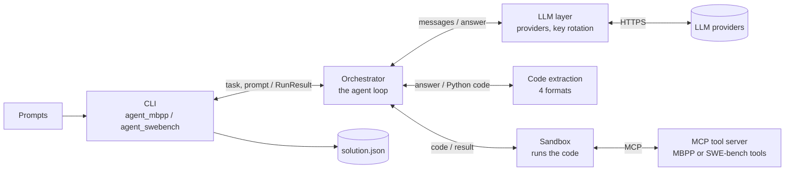
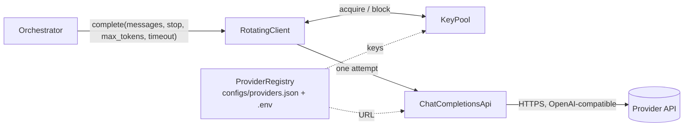
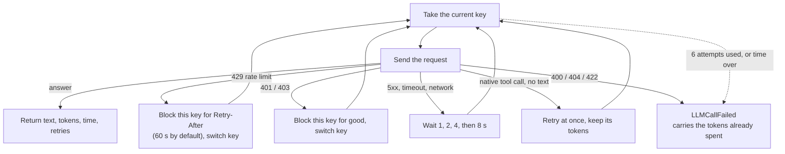
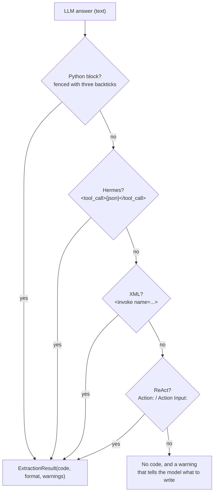
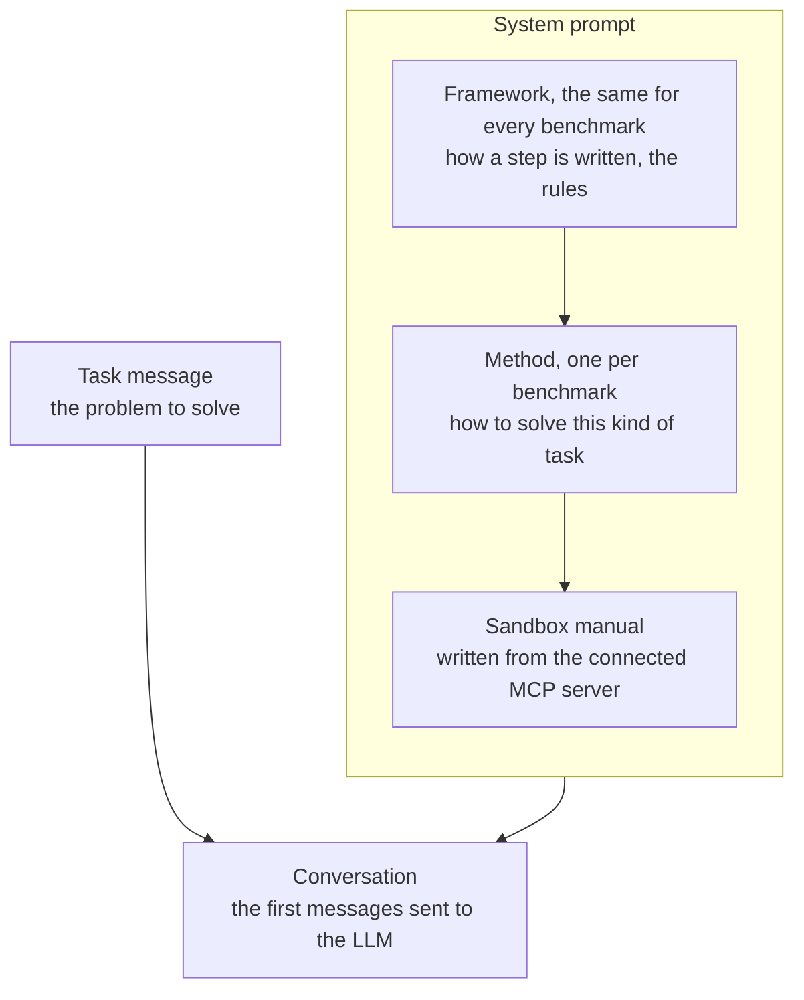
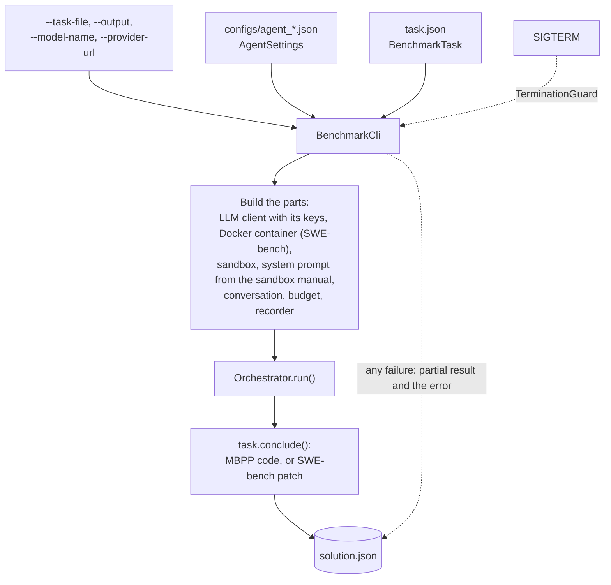
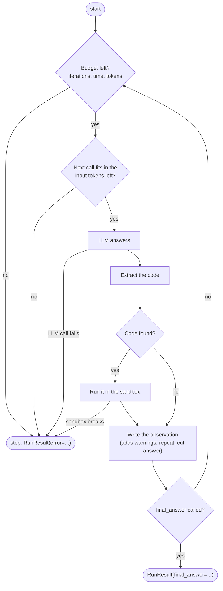
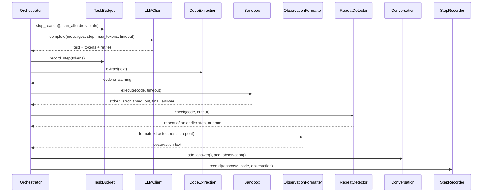

## Description

Agent Smith is a code agent built from scratch, without any agent
orchestration library. It solves a task by repeating a loop: the language
model writes a thought and a block of Python, the code runs in a sandbox,
and the result goes back to the model as an observation. The loop ends when
the model calls `final_answer`, or when a limit is reached.

The same agent runs two benchmarks:

- **MBPP**: write one Python function that passes a list of assertions.
- **SWE-bench**: fix an issue in a real repository, inside a Docker
  container, and return a patch.

The agent works with free LLM providers only (Mistral, Gemini, Cloudflare
Workers AI, Nvidia, OpenRouter). Each provider has several API keys, and the
agent rotates between them when one is rate limited.

## Instructions

### Run the agent

```bash
# MBPP
uv run python -m agent_mbpp \
    --task-file task.json --output solution.json \
    --model-name codestral-latest \
    --provider-url https://api.mistral.ai/v1

# SWE-bench (the task image must be available in Docker)
uv run python -m agent_swebench \
    --task-file task.json --output solution.json \
    --model-name codestral-latest \
    --provider-url https://api.mistral.ai/v1
```

`--provider-url` selects the provider; the matching keys are found in `.env`.
The default settings are in `configs/agent_mbpp.json` and
`configs/agent_swebench.json` (model, iteration limit, how many observations
stay in full, and so on). The agent always writes `solution.json`, whatever
happens during the task.

## System architecture



Each box is a package of `src/`. The orchestrator only sees interfaces: an
`LLMClient` for the model and a sandbox port for the code execution. Each
part is passed to its constructor, so it can be replaced by a fake object.

The CLI is the entry point of each agent: it reads the command-line options, builds every part of the agent, runs the loop and writes `solution.json`. Nothing is typed in the terminal while the agent runs.

| Package | Role |
|---|---|
| `src/cli` | Command lines, task loading, wiring of all parts, `solution.json` |
| `src/orchestrator` | The loop, the budget, the conversation, the feedback to the model |
| `src/llm` | One HTTP call, retries, key rotation, token counting |
| `src/extraction` | From the model's answer to Python code |
| `src/prompts` | The system prompt and the task message of each benchmark |
| `src/sandbox` | Code execution and MCP client (see "Sandbox design") |

### LLM layer

`RotatingClient` sends the conversation to a provider and hides everything
that can go wrong: rate limits, dead keys, outages and timeouts. Every
provider speaks the OpenAI chat format, so switching provider means changing
`--provider-url`, not code.



How one call reacts to each failure:



A call ends after 6 attempts, or when its time is up. When every attempt
fails, `LLMCallFailed` carries the tokens already spent, so the trace stays
honest. Tokens of discarded native-tool-call attempts are added to the answer
that finally succeeds, because the provider counted them.

The clock and the sleep function are injected, so long waits can be
simulated instantly when checking the retry logic. To add a provider, add an entry in `configs/providers.json`
and its keys in `.env`: no code.

### Code extraction

Models do not always answer in the same format. `CodeExtraction` finds the
code in the answer and turns it into Python, so the sandbox only ever sees
Python.



The first extractor that recognises its format decides. The chain always
returns a result, so the orchestrator never handles `None`.

| Format | What the model writes | Python handed to the sandbox |
|---|---|---|
| Python block (primary) | a `python` fenced block, then `<end_code>` | the block, as is |
| Hermes | `<tool_call>{"name": "read_file", "arguments": {...}}</tool_call>` | `read_file(filepath=...)` |
| XML | `<invoke name="read_file"><parameter name="filepath">...` | `read_file(filepath=...)` |
| ReAct | `Action: read_file` and `Action Input: {...}` | `read_file(filepath=...)` |

When a block is malformed but can still be interpreted (for example a fence
that is not closed), the result says how it was repaired, and the model reads
that warning in the next observation. ReAct comes last on purpose: it is the
loosest format, so a stray `Action:` line is only considered when nothing
else matches.

### System prompt

One class per benchmark builds the two texts that start a task.



The tools are never described in the prompt files. The manual comes from the
sandbox, built from the tool schemas of the connected MCP server, so an
unknown server works the same way.

| | MBPP (`MbppPrompt`) | SWE-bench (`SweBenchPrompt`) |
|---|---|---|
| Goal | write one Python function | fix an issue in a real repository |
| Steps | write the function, check it with `run_tests(code, TESTS)` in the same block, fix, then `final_answer(code)` | find the code, read it, reproduce the bug, fix with `edit_file`, run the tests, then `final_answer(get_patch())` |
| Size | as short as possible: the system prompt is sent at every step and MBPP allows 6,000 input tokens for the whole task | longer, with a worked example of three steps |

Each line of the prompt costs tokens at every step, so a change is measured
before it is kept: a few lines can move the pass rate on MBPP. The SWE-bench
prompt also tells the agent to work only from the repository and the tools,
and never to look for the fix in a pull request, an issue or any outside
source.

### Command lines and containers

`BenchmarkCli` holds everything the two agents share. A subclass only says
which benchmark it runs, how to read its task and which limits apply.



What always happens:

- `solution.json` is written whatever the outcome of the task. The exit code
  is 0 once the file is written, 130 after Ctrl+C, and 1 only if the file
  cannot be written.
- SIGTERM becomes an exception (`TerminationGuard`), and Ctrl+C stops the run
  the same way: what is known is still written before the process ends,
  without a traceback.
- The clock starts when the process starts, not at the first LLM call,
  because the evaluation counts the launch too.

For SWE-bench, `DockerContainer` starts the task image, the MCP tools work
inside it, and the container is removed at the end. The container has no
network (`--network none`): the model's commands cannot download anything or
fetch a solution from outside. Four layers make sure none is left behind:

| Situation | What removes the container |
|---|---|
| Normal end, or an ordinary error | the `with` block, patiently |
| SIGTERM or Ctrl+C | a short removal, then a detached process if it is not enough |
| `kill -9`, or the process dies without running code | a detached guard, within one or two seconds |
| Even the guard cannot act | the container deletes itself after its lifetime |

The guard is a small process started with the container. It waits on a pipe
whose other end only the agent holds. When the agent dies, even by `kill -9`,
the kernel closes that end, and the guard runs `docker rm -f`.

## Agent loop

The loop is **Thought, Code, Observation**: call the LLM, run the code it
wrote, give it the result, and repeat until `final_answer` or a limit.



One step, from the inside:



### Limits

The limits are counted over the whole task, not per call.

| | Iterations | Input tokens | Output tokens | Timeout |
|---|---|---|---|---|
| MBPP | 10 | 6,000 | 1,500 | 120 s |
| SWE-bench | 30 | 300,000 | 10,000 | 900 s |

`TaskBudget` tracks what is used and what is left. Before each call, the
orchestrator estimates the size of the next request and stops if it does not
fit in the input tokens left. A safety margin keeps the agent below the
limits, so the run ends with a proper `solution.json` instead of being cut.

### The model always gets feedback

The sandbox reports facts, and `ObservationFormatter` turns each one into a
sentence the model reads. No failure is silent.

| Case | What the model reads |
|---|---|
| No code in the answer | the expected format |
| Code repaired before running | how it was repaired |
| Timeout | "time limit reached, the output is partial" |
| Output too long | the start and the end, with the size cut |
| Code ran, printed nothing | "ran without error and printed nothing" |
| Variables lost after a restart | "define them again" |
| Same code, same result as a step before | "sending it again will not help" |
| Own answer cut at the token limit | "write a shorter answer" |

### Keeping the input small

Every call sends the whole conversation again, so an old observation costs
its size at each later step. `Conversation` sends only the last
`keep_last_observations` observations in full and replaces older ones with a
short marker. The full text stays in memory, and only the view sent changes.

### Stop sequences and repeats

The model is asked to stop on `<end_code>`, `</tool_call>` and
`Observation:`. Without it, a model can write an observation that it
invented and carry on from there.

`RepeatDetector` spots the same code giving the same result as an earlier
step and adds a warning to the observation. It warns but does not stop the
loop. The ablation study below measures what it brings.

### Where to change things

| To change | Where |
|---|---|
| A limit | `TaskLimits.mbpp(...)` and `.swebench(...)` in `src/orchestrator/models.py` |
| How many observations stay in full | `keep_last_observations` in `configs/agent_*.json` |
| A feedback sentence | the constants at the top of `ObservationFormatter` |
| The repeat detector | `detect_repeats` in `configs/agent_*.json` |
| The stop sequences | `Orchestrator._STOP_SEQUENCES` |

## Sandbox design


## Tool implementation details


## Benchmark results and analysis

The full report is in [`BENCHMARK_REPORT.md`](BENCHMARK_REPORT.md). The
`solution.json` files behind it are in `benchmark/`.

### Setup

The agent and its prompt were frozen before the final run. Ten models from
five free providers (Mistral, Gemini, Cloudflare Workers AI, Nvidia,
OpenRouter) ran on the same three SWE-bench tasks (`django__django-11066`,
`scikit-learn__scikit-learn-13439`, `pydata__xarray-4629`), with the limits of
the subject (30 iterations, 300,000 input tokens, 10,000 output tokens, 900 s).
A task counts as solved when the official validation says `PASSED`. The three
tasks come from three different repositories, and the reference model passes
all of them, so a failure says something about the model being tested.

### Results

| Model | Provider | Solved | Input tokens | Time (s) |
|---|---|---|---|---|
| `ministral-8b-latest` | Mistral | **3/3** | 98,800 | 301 |
| `codestral-latest` | Mistral | **3/3** | 205,284 | 575 |
| `nemotron-3.5-bolt-e4b` | Nvidia | 2/3 | 140,869 | 121 |
| `ministral-14b-latest` | Mistral | 2/3 | 163,628 | 489 |
| `gemini-3.5-flash-lite` | Gemini | 2/3 | 318,073 | 373 |
| `laguna-xs-2.1` | Nvidia | 2/3 | 331,474 | 245 |
| `nemotron-3-ultra-550b-a55b` | Nvidia | 1/3 | 366,110 | 341 |
| `mistral-small-3.1-24b` | Cloudflare | 1/3 | 478,511 | 346 |
| `gemini-3.1-flash-lite` | Gemini | 0/3 | 91,292 | 329 |
| `nemotron-3-ultra-550b-a55b:free` | OpenRouter | 0/3 | 418,370 | 266 |
| `nemotron-3-120b-a12b` | Cloudflare | 0/3 | 495,109 | 527 |

Iterations, output tokens and time per task are in the report. Two more
Cloudflare models (`llama-4-scout`, `glm-4.7-flash`) could not be tested: the
free daily quota of the provider was used up, and they are not counted.

### What we see

- **Two models solve all three tasks**, both from Mistral. `ministral-8b` needs
  half the input tokens and half the time of `codestral` (98,800 against
  205,284 tokens, 301 s against 575 s).
- **Loops are the main way to fail.** Of 33 runs, 16 pass and 17 fail, and 12
  of the failures end at the 30-iteration limit. The repeat warning does not
  stop them: the model reads it and sends the same call again.
- **Some models submit without checking.** Two passing runs (`gemini-3.5`)
  never called `run_tests`. Among the 14 passing runs that did, 11 submitted
  right after the tests passed.
- **Provider and model are not the same variable.** `nemotron-3-ultra` solves
  one task on Nvidia and none on OpenRouter, where the model calls its tools
  without `print` and reads "printed nothing" until the limit.
- **Free quotas are a real constraint.** The Cloudflare daily quota stopped
  two models after two others had used it, which is why the benchmark uses five
  providers and not the minimum.

The task container has no network access (`--network none`). A review of the
runs found two models that had installed packages with `pip` before this was
set; the report explains how those runs were handled.

### Ablations

Each variant changes one thing, with `codestral-latest` on six SWE-bench
Verified tasks (`sympy__sympy-14711`, the unstable one, three times: 8 runs per
condition):

| Condition | Change | Tasks passed (of 8) |
|---|---|---|
| R | reference settings | 6 |
| A1 | without `find_references` and `list_files` | 5 |
| A2 | `max_observation_chars` 12,000 instead of 6,000 | 5 |
| A3 | repeat detector off | 6 |

With eight runs per condition, a gap of one task is within the noise: each
condition was measured twice, and the two measurements differ by one task at
most. Removing two tools costs nothing measurable, a larger observation limit
gains nothing, and the repeat detector warns but does not stop a loop. None of
the three changes shows a gain in pass rate.

### Selected model

Each agent has its own default model, in `configs/agent_*.json`:

- **SWE-bench: `codestral-latest`.** It solves 3/3, and the ablations were run
  on it. `ministral-8b-latest` also solves 3/3 for half the cost.
- **MBPP: `nemotron-3.5-bolt-e4b` (Nvidia).** Chosen from 15 exam-like runs
  (5 random tasks each) per candidate. The three best models solve 85 to 88 %
  of the tasks, which is within noise, but this one needed no retry and no task
  took more than 25 s, where the two Mistral models had retries on two tasks
  out of three and tasks up to 78 s. MBPP allows 120 s per task and the exam
  does not re-run a failed task. The two agents also use different providers,
  so they do not share rate limits when they run at the same time.
Models to disregard (0/3): `nemotron-3-120b-a12b`, `gemini-3.1-flash-lite`
and the OpenRouter version of `nemotron-3-ultra`.

## Resources

- [MCP servers](https://www.stephane-robert.info/docs/developper/programmation/python/mcp/)
- OpenAI-compatible chat completions API, used by all providers.
- SWE-bench and MBPP, the two benchmarks.

### Use of AI

#### Quentin

Claude Code (Anthropic) was used as a pair programmer for the parts written
by Quentin: the LLM layer, the code extraction, the orchestrator, the
prompts, the command lines and the benchmark scripts. It was also used to
write the simulation scripts used to check each part, the benchmark
aggregation script, the notes and the draft of this README.

The work was delivered one class or one method at a time. Each unit was read,
run by hand and validated before the next one. The design choices were made by
Quentin: object-oriented style with injected dependencies, `temperature 0`,
a per-call timeout of 60 s, 6 attempts with a 1, 2, 4, 8 s backoff, the
choice of providers and models, and the limits kept on each ablation.

Claude also analysed test failures (for example the provider quota errors and
the loops of some models) and proposed fixes, which Quentin accepted or
refused. Claude Code did not write or change Bruno's part (sandbox, MCP
client and servers, Docker): it only read that code.

#### Bruno

